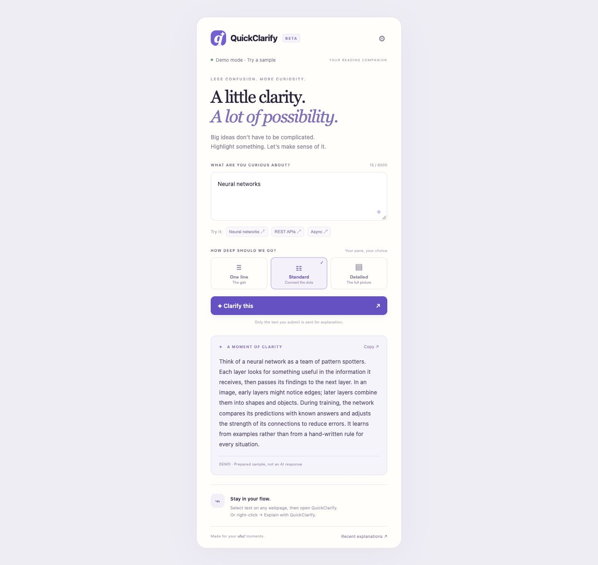
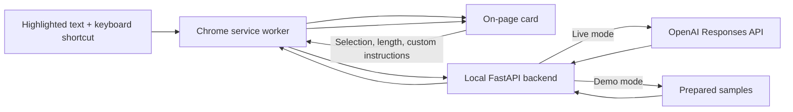

# QuickClarify

**Highlight. Press. Understand.**

QuickClarify is an AI-powered Chrome extension that brings answers to the page you are reading. Highlight a question, a confusing paragraph, or an algorithm problem and press a keyboard shortcut. An explanation card appears on the webpage, helping you keep your place and continue learning.

Built with **Python · FastAPI · OpenAI Responses API · Chrome Manifest V3 · JavaScript**.



## Why QuickClarify?

Reading technical material often means interrupting your work to search for definitions or copy text into another app. QuickClarify makes that moment simpler: select the text and ask for help in place.

The goal is to make difficult ideas easier to understand while keeping the reader in control of what is shared and how much detail they receive.

## What it does

| Selected text | Intended response |
| --- | --- |
| A question or math problem | A direct answer, with supporting calculations when useful |
| A paragraph or technical concept | A plain-language explanation of the main ideas |
| A coding or algorithm problem | Working code, with explanation and complexity according to the selected length |

Choose your level of detail:

- **One line:** a concise answer; coding problems receive a compact implementation.
- **Standard:** an explanation or solution with the key steps; coding problems include code and a short explanation.
- **Detailed:** a fuller walkthrough, examples, and relevant edge cases.

Python 3 is the default for coding answers. A language specified in the selected problem or saved custom instructions takes precedence. AI responses can contain mistakes; verify calculations and review generated code before running it.

Additional features include saved custom instructions, a right-click action, copying answers, and local history for the latest 20 popup explanations.

## Requirements

- **Python 3.10 or newer**
- **Google Chrome** with Developer mode enabled to load the unpacked extension
- An **OpenAI API key and funded API project** for live answers
- **Node.js 20+** only if you want to run the JavaScript tests

There is no JavaScript build step. The backend must be running on your computer while you use the extension.

## Quick start

### 1. Get the project

Clone the repository and enter the project directory:

```sh
git clone https://github.com/tvivekanandareddy/QuickClarify---AI-Powered-Chrome-Extension.git
cd QuickClarify---AI-Powered-Chrome-Extension
```

Alternatively, choose **Code → Download ZIP** on GitHub, extract it, and open a terminal in that folder.

### 2. Set up the backend

On macOS or Linux:

```sh
python3 -m venv .venv
source .venv/bin/activate
python -m pip install -r requirements.txt
cp .env.example .env
```

On Windows PowerShell:

```powershell
py -m venv .venv
.\.venv\Scripts\python.exe -m pip install -r requirements.txt
Copy-Item .env.example .env
```

The copied `.env` starts in **demo mode**. You can try prepared explanations for neural networks, REST APIs, and asynchronous programming without an API key. Other selections show setup guidance. Demo mode does not generate answers or apply custom instructions.

### 3. Start the server

On macOS or Linux, with the virtual environment activated:

```sh
python -m uvicorn backend.main:app --host 127.0.0.1 --port 8000
```

On Windows PowerShell:

```powershell
.\.venv\Scripts\python.exe -m uvicorn backend.main:app --host 127.0.0.1 --port 8000
```

Keep this terminal running. Press **Ctrl+C** to stop the server.

- [Browser playground](http://127.0.0.1:8000/popup.html): try the interface before installing the extension.
- [Interactive API documentation](http://127.0.0.1:8000/docs): inspect and test the REST endpoints.
- [Health check](http://127.0.0.1:8000/health): confirm the server is running and see whether demo mode is enabled.

### 4. Load the extension in Chrome

1. Open `chrome://extensions`.
2. Turn on **Developer mode**.
3. Click **Load unpacked** and choose the project's **extension** folder—the folder containing `manifest.json`.
4. Open a regular webpage and highlight some text.
5. Press **Command+Shift+K** on Mac or **Ctrl+Shift+K** on Windows/Linux.

The response appears directly on the page. Change its length with the card's buttons, copy it, or press **Escape** to close it.

If the shortcut is unavailable, assign a key at `chrome://extensions/shortcuts`. You can also right-click selected text and choose **Explain with QuickClarify**.

## Enable live AI answers

1. Create your own key in the [OpenAI API dashboard](https://platform.openai.com/api-keys). The backend uses the Responses API; a restricted key needs permission to write Responses.
2. Configure API billing for your project. This API-key integration is billed separately from a ChatGPT subscription.
3. Open your local `.env` and configure it:

```dotenv
DEMO_MODE=false
OPENAI_API_KEY=replace_with_your_own_key
OPENAI_MODEL=gpt-4.1-mini
```

4. Restart the backend after changing `.env`.

The model is configurable: select a text-capable Responses API model supported by your account. Availability and pricing can change; consult the [OpenAI model catalog](https://developers.openai.com/api/docs/models) and [API pricing](https://developers.openai.com/api/docs/pricing).

**Supply your own key locally. This repository includes only `.env.example`, never a working credential.**

## Personalize your answers

Pin QuickClarify from Chrome's extensions menu and open its popup. Click the settings gear to save instructions, such as:

- “Explain for a beginner using everyday examples.”
- “Use Java for coding problems.”
- “Keep explanations practical and avoid jargon.”

Choose a default length in the popup. The keyboard shortcut uses those saved preferences automatically. The popup also supports pasted text and a **Show on page** action.

## How it works



The extension injects scripts after a user action using `activeTab` and `scripting`. The service worker contacts a fixed local backend. The backend validates the request and constructs instructions appropriate for answering questions, explaining concepts, or producing code. The API key remains on the backend.

## Privacy and secrets

- `.env`, environment variants, private key files, virtual environments, caches, and logs are excluded by `.gitignore`. Only the empty `.env.example` template belongs in Git.
- The extension sends the selected text, chosen length, and custom instructions. It does not submit the page URL or surrounding page content.
- In live mode, those request contents are sent to OpenAI. Requests use `store=False`; this does not override OpenAI's other data-handling policies.
- Generated content is inserted as text, rather than interpreted as page HTML.
- Popup history is stored on your device in `chrome.storage.local` (or browser localStorage in the playground). Clear it through **Recent explanations → Clear**. On-page answers are not added to history.
- Keep the backend bound to **127.0.0.1**. This local application has no authentication or rate limiting and is not prepared for public server deployment.

See [SECURITY.md](SECURITY.md) for more on handling keys and reporting security issues.

## API

### `GET /health`

Returns server status and the demo-mode flag.

### `POST /api/explain`

```json
{
  "text": "What is an API?",
  "length": "standard",
  "prompt": "Use an everyday analogy."
}
```

`length` accepts `one_line`, `standard`, or `detailed`. Selected text must contain 1–6000 characters; custom instructions allow up to 1000 characters. The response includes `explanation`, `length`, `demo`, and `model`. Invalid input returns HTTP 422; missing credentials return 503. Provider and connection errors produce actionable error messages.

## Project structure

```text
backend/
  main.py                 FastAPI routes, validation, prompts, and OpenAI integration
extension/
  manifest.json           Permissions, keyboard command, and entry points
  background.js           Service worker, shortcut dispatch, and fixed API proxy
  selection.js            Selected-text reader for accessible document contexts
  content.js              Isolated on-page answer card
  popup.html              Popup and playground interface
  popup.css               Interface styles
  popup.js                Settings, history, selection, and API workflows
  index.html              Playground entry point
tests/
  test_api.py             API tests using a mocked OpenAI client
  test_extension.cjs      Shortcut and selection tests using a mocked Chrome API
docs/
  preview.png             Demo interface screenshot
.env.example              Safe environment template
.github/workflows/ci.yml  Automated checks without API credentials
```

## Development and tests

Install the dependencies using the quick-start instructions, then run:

```sh
python -m pytest -q
node --test tests/test_extension.cjs
```

Tests do not need an API key and make no paid OpenAI requests. They cover request validation, demo behavior, mocked live API calls, shortcut dispatch, selection capture, and restricted-page handling. Actual Chrome permissions and shortcut assignment still require manual browser testing.

For backend development, add `--reload` to the server command. After editing extension files, reload QuickClarify at `chrome://extensions` and refresh the webpage.

## Troubleshooting

| Problem | What to check |
| --- | --- |
| Backend offline | Start the server on `127.0.0.1:8000` and keep its terminal running. |
| Demo message instead of a live answer | Set `DEMO_MODE=false`, provide your key in `.env`, and restart the server. |
| Quota or rate-limit error | Check your API project balance, billing, and usage limits; retry after any temporary limit clears. |
| Shortcut does nothing | Check `chrome://extensions/shortcuts` for a conflicting or unassigned combination. |
| Highlighted text is not captured | Refresh the webpage after reloading the extension, then select text and retry. |
| Chrome internal page, Web Store, PDF, or inaccessible frame | Try a regular webpage or paste the text into the popup. |
| Port 8000 already in use | Stop the existing server before starting another. The extension currently targets port 8000. |
| Key or model rejected | Confirm the key's Responses permissions and the model's availability in your API project. |

## Contributing

Bug reports and improvements are welcome. Include reproduction steps, expected behavior, and relevant error messages. Remove API keys and private text from reports and screenshots. Run both test suites before proposing changes.
